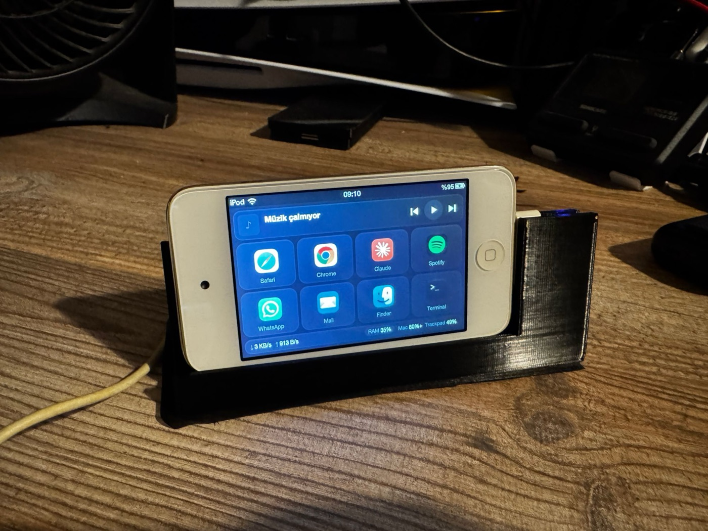

# Drawer Deck

Turn any phone or tablet with a web browser into a Stream Deck-style control panel for your Mac: an iPhone you use every day, or an old iPod touch or PS Vita from your drawer. Nothing is installed on the device: a small server runs on the Mac and the device opens a page in its browser.


- **8 big keys** that open apps, websites or Shortcuts, with real app icons
- **Now playing** from Spotify or Apple Music, with cover art and playback controls
- **Live stats:** network speed, Mac and Bluetooth battery levels, RAM usage
- **RAM list:** tap the bottom bar to see the heaviest apps and quit one
- **Editor on the Mac:** assign keys, rename them and drag to reorder; the device updates by itself
- **No dependencies:** plain Node.js, and ES5 on the device so very old browsers work

The interface text is in Turkish.

## Devices

It runs in the browser, so any device on the same Wi-Fi can use it. The layout adapts to the screen and switches between 2×4 and 4×2 keys with the orientation.

Tested on real hardware:

| Device | Browser |
| --- | --- |
| iPod touch 4th gen | Safari, iOS 6.1.6 |
| PS Vita | Built-in browser, firmware 3.74 |

Modern iPhone and iPad screen sizes were checked in an emulated browser, not on real devices. Icons stay small on tablets.

The Mac side needs macOS and Node.js 18 or newer.

## Install

```bash
git clone https://github.com/wcrow685/drawer-deck.git
cd drawer-deck
./install.sh
```

This installs `Drawer Deck.app` in `/Applications` and a LaunchAgent, so the server starts at every login and restarts if it crashes. Your settings live in `~/Library/Application Support/DrawerDeck` and are kept when you reinstall.

To try it without installing, run `node server.js`.

## Use

1. Open **Drawer Deck** on the Mac. A notification shows the address and the editor opens.
2. On the device, join the same Wi-Fi and open `http://<mac-ip>:8787`.
3. On iOS, use **Add to Home Screen** for full screen, and set Auto-Lock to Never.

The address comes from the Mac you run it on, so there is nothing to configure. If your router later gives the Mac a new address, saved shortcuts stop working. To avoid that, reserve a fixed IP for the Mac in your router's DHCP settings.

macOS asks for permission the first time the server controls Spotify or Music.

## Key types

Use the editor, or edit `config.json` in the settings folder:

```json
{ "label": "Mail", "app": "Mail" }
{ "label": "News", "url": "https://example.com" }
{ "label": "Focus", "shortcut": "My Shortcut" }
```

## Stand

`stand/` has a 3D-printable landscape stand for the iPod touch 4th gen, with a charging plug built in: [STL](stand/ipod-touch4-stand.stl) and [OpenSCAD source](stand/ipod-touch4-stand.scad).



It prints flat on its base without supports. It has been printed and tested with one iPod touch and one 30-pin cable. Plugs differ between cables, so measure yours first. Change `plug_w`, `plug_t`, `plug_len` and `plug_y` in the source if needed, then export a new STL.

## Security

**Only use this on a network you trust.** The deck page has no password, so anyone on the same network can open it, press keys and quit the apps in the RAM list. Keys can only run what you configured.

The editor only works from the Mac itself, and the server refuses requests that come from other websites.

## Uninstall

```bash
launchctl bootout gui/$(id -u)/io.github.wcrow685.drawerdeck
rm ~/Library/LaunchAgents/io.github.wcrow685.drawerdeck.plist
rm -rf "/Applications/Drawer Deck.app" ~/Library/Application\ Support/DrawerDeck
```

## Credits

Inspired by [OldPhoneDeck](https://github.com/GLAUCOMA82/OldPhoneDeck). Drawer Deck is a separate implementation and shares no code with it.

## License

[MIT](LICENSE)

---

## Türkçe özet

Tarayıcısı olan her telefon ve tableti Mac için Stream Deck benzeri bir panele çevirir: her gün kullandığın iPhone'u ya da çekmecedeki eski iPod touch veya PS Vita'yı. Cihaza bir şey kurulmaz: Mac'te küçük bir sunucu çalışır, cihaz tarayıcısından sayfayı açar. Kurmak için `./install.sh` çalıştır, sonra aynı Wi-Fi'daki cihazda `http://<mac-ip>:8787` adresini aç. Deste sayfasında şifre yok, sadece güvendiğin ağlarda kullan. iPod touch 4 için 3D baskı stand `stand/` klasöründe.
